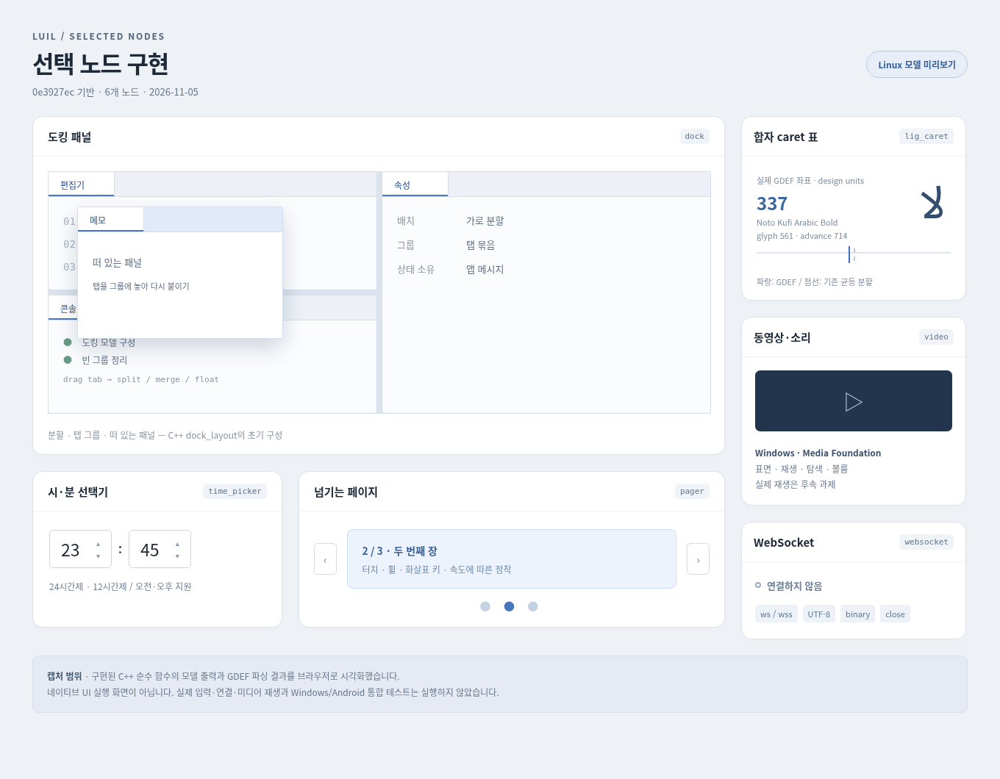

# 선택 노드 여섯 개 구현

기준은 `0e3927ecb2c48e145c5b553ec797103be3bcc646`이다. 2026-11-05에 고른 목록은
`dock`, `pager`, `time_picker`, `lig_caret`, `video`, `websocket` 여섯 개다.
제목에 적힌 일곱 개 중 하나는 사용자가 제외했다.

이 변경은 구현과 컴파일·정적 확인까지다. 기능·회귀·네이티브 통합 테스트는 실행하지 않았다.
Linux는 정식 앱 지원 플랫폼이 아니므로 아래 캡처는 모델 시각화이며 네이티브 UI 실행 증거가 아니다.



## 추가한 것

| 노드 | 공개 진입점 | 구현 범위 |
| --- | --- | --- |
| 도킹 패널 | `ui/dock_element.h` | 분할 tree, 탭 선택·순서·그룹 이동, 가장자리 drop, 같은 표면 안의 떠 있는 패널, 빈 그룹·분할 정리 |
| 넘기는 페이지 | `ui/pager_element.h` | 가로 페이지 배치·clip, 터치 이동, 속도 투영과 정착, 취소 정착, 휠·키보드 이동 |
| 시·분 선택 | `ui/time_picker_element.h` | 숫자 칸 두 개, 스핀 버튼, 24/12시간제, 오전·오후, 범위 판정, 번역 기본 문구 |
| 합자 caret | 기존 `ui/text_layout.h` | GDEF 좌표를 공통 layout의 caret·hit test·선택·IME 경로에 반영 |
| 동영상·소리 | `win32/media_player.h`, `ui/video_element.h` | Windows MFPlay, 네이티브 영상 표면, 비동기 열기·상태, 재생·일시정지·탐색·볼륨·음소거, 오디오 전용 |
| WebSocket | `net/websocket_client.h` | Windows WinHTTP, Android 기본 Socket/SSLSocket, ws/wss, 텍스트·바이너리, 조각 재조립, ping/pong, 닫기·종료 |

공개 헤더는 umbrella와 CMake 목록에 넣었다. 새 element kind는 기존 번호 뒤에 붙였고 검사기 이름표도 넣었다.

## 도킹과 페이지의 상태

`dock_layout`과 페이지 offset은 앱의 logic thread가 소유한다. 액션에서 상태를 직접 바꾸지 않는다.

```cpp
config.change = [](luil::dock_command command) {
    return luil::make_app_action(std::move(command));
};
// logic_driver::handle에서:
(void)luil::apply_dock_command(layout, command);
```

도킹 node의 key와 panel key는 각각 layout 안에서 유일해야 한다. 분할은 자식 둘,
탭 그룹은 자식 없이 panel 목록을 가진다. `valid_dock_layout`은 중복·잘못된 구조를 거절한다.
`apply_dock_command`는 사본에서 이동한 뒤 검증해 반영하므로 잘못된 목적지 때문에 panel이 사라지지 않는다.
`content` factory는 선택된 panel만 짓는다. 편집 초안은 factory 밖 앱 상태로 보존한다.

떠 있는 패널은 같은 표면 안에서 clip된다. 탭을 빈 곳으로 끌어 다시 띄우거나 다른 그룹에 붙일 수 있다.
별도의 OS 창을 만들려는 앱은 `dock_command::release`의 화면 좌표를 읽고 기존 다중 창 경로로 처리한다.
기본 helper는 OS 창을 만들지 않는다. `reposition`·`raise`는 앱이 자체 제목줄·명령에 연결할 수도 있다.

페이지 offset의 단위는 페이지다. `1.25`는 두 번째 장에서 다음 장으로 1/4만큼 간 자리다.

```cpp
pager_config.change = [](luil::pager_command command) {
    return luil::make_app_action(command);
};
// logic_driver::handle에서 현재 상태에 적용한다:
offset = luil::apply_pager_command(offset, page_count, command);
```

이동 메시지는 변화량이라 새 frame 앞에 이동이 여러 번 와도 누락되지 않는다.
손을 떼면 일반 스크롤 관성 대신 `scroll_source::settle`을 한 번 부른다.
속도의 0.18초 투영을 최대 한 페이지로 제한한 뒤 가장 가까운 페이지로 정착한다.
정착은 즉시 반영한다. 부드럽게 이어 붙이는 애니메이션은 앱이 기존 transition을 연결할 수 있다.
기존 스크롤은 settle을 비워 지금의 관성을 유지한다.

## 시·분과 합자

시·분 칸은 `time_picker_hour`, `time_picker_minute` kind와 config의 owner를 쓴다.
`interaction_policy::text_target_of`에 두 kind를 등록하고 타자·붙여넣기·IME를 기존
`apply_text_edit`와 `make_text_input_view`로 잇는다. 스핀 변경도 초안 전체를 바꾸는 메시지다.
`read_time_picker`가 범위를 판정하며, 12 AM은 0시, 12 PM은 12시로 읽는다.

GDEF는 모양 잡기가 켜진 경로에서 최종 glyph의 face로 읽는다.
합자 하나가 glyph 하나와 대응하고 글자소 내부 경계 수와 caret 수가 맞을 때만 쓴다.
Format 1과 device offset이 없는 Format 3의 design-unit 좌표를 실제 글꼴 크기·가로 배율로 옮긴다.
RTL은 시각 좌표와 문서 경계를 역순으로 대응한다. 잘못된 offset·표 크기는 읽지 않는다.
Format 2의 윤곽 점, device/variation 보정, 누락·손상된 표, 맞지 않는 개수는 기존 균등 분할로 돌아가며
내부 경계가 근사라는 표시를 유지한다. 이번 변경은 이 미지원 형식의 해석을 추가하지 않는다.

## Windows 미디어 연결

운영체제 코덱을 쓰므로 별도 미디어 의존성을 받지 않는다. CMake는 Windows에 `mfplay`, `mfuuid`, `propsys`를 잇는다.
Android/Linux 재생 백엔드는 추가하지 않았다. `parent_window == nullptr`면 오디오 전용이다.

미디어 객체와 HWND는 UI thread에 둔다. `window_delegate`의 다음 훅으로 `run_application_window`에도 연결할 수 있다.

- `on_native_window_created(host, window)`: `on_started` 앞에 주 창 HWND를 받는다.
- `on_native_frame(host, frame)`: 읽기 전용 tree에서 video slot을 찾아 네이티브 표면의 자리를 맞춘다.
- `on_native_window_destroying(host)`: 모든 종료 경로에서 host shutdown 앞에 callback과 표면을 끝낸다.

```cpp
// on_native_window_created:
luil::win32::media_player_config config {};
config.parent_window = window;
config.deliver = [&host](luil::win32::media_event event) {
    host.post_app_message(luil::app_message { std::move(event) });
};
player = luil::win32::media_player::create(std::move(config), error);
if (player != nullptr)
    (void)player->open(source, error);

// on_native_frame: video_id는 앱이 video_element에 준 안정적인 id다.
const auto* slot = frame.tree != nullptr ? frame.tree->find(video_id) : nullptr;
if (player != nullptr)
    player->set_video_bounds(slot != nullptr ? slot->bounds() : luil::rect_f {}, slot != nullptr);

// on_native_window_destroying:
player.reset();
```

버튼의 액션은 `app_ui_command`를 반환하고 delegate의 `execute_app_ui_command`에서
`play`, `pause`, `rewind`, `seek`, `volume`을 호출한다. `snapshot`으로 진행 위치를 읽을 수 있다.
`deliver`는 MF worker에서 오므로 UI/logic 상태를 직접 고치거나 여기서 player를 없애지 않는다.
같은 UI thread에서 stop한 뒤에는 배달하지 않는다. 원본을 연달아 열면 이전 열기 완료는 버린다.

영상은 Skia 합성 텍스처가 아닌 네이티브 자식 창이다. 회전·둥근 clip·부분 scroll clip을 지원하지 않는다.
팝업·인앱 modal에 가려져야 할 때 앱이 `set_video_bounds(..., false)`로 감춘다.
자막·DRM·녹화는 이번 범위 밖이다. 코덱 설치 여부·실제 오디오 출력은 Windows에서 후속 확인한다.

## WebSocket 연결

HTTP처럼 배출구 하나에서 불변 값을 앱 메시지로 옮긴다. 연결 하나에 client 하나이고 자동 재접속은 하지 않는다.

```cpp
luil::net::websocket_client_config config {};
config.deliver = [&host](luil::net::websocket_event event) {
    host.post_app_message(luil::app_message { std::move(event) });
};
auto client = luil::net::websocket_client::create(
    { .url = u8"wss://example.com/socket" }, std::move(config), error);
```

`opened` 뒤부터 `send_text`·`send_binary`를 받는다. `false`면 큐 상한·연결 상태 때문에 받아들이지 않은 것이다.
기본 메시지와 대기 바이트 상한은 각각 8 MiB, 대기 개수는 64다. 메시지 상한의 허용 최댓값은 64 MiB다.
UTF-8, close code/길이, Android frame 길이·mask·continuation·control 규칙을 확인한다.
Windows는 WinHTTP가 framing과 ping/pong을 맡고 Android는 Java 전송부가 맡는다.
Android는 앱의 평문 통신 정책을 지키고 TLS의 신뢰 사슬·호스트 이름을 검사한다.
URL은 ASCII escape한 ws/wss 주소이며 URL 자격 증명·재지정·사용자 지정 헤더·서브프로토콜·압축 확장은 지원하지 않는다.

`close`는 닫기 frame을 보내고 기본 3초 동안 응답을 기다린다. `stop`은 소켓을 끊고 reader/writer를 join한다.
돌아온 뒤 callback은 없다. callback 안에서 stop/소멸하면 자기 reader를 join하므로 금지다.
앱은 worker 종료 단계에서 client를 끝내고 host보다 먼저 배출구를 놓는다.

Android 소비자는 다음 둘을 APK에 포함해야 한다. 예제 Gradle은 Java source 폴더를 이미 포함한다.

```kotlin
android.sourceSets.getByName("main").java.srcDir("<luil>/src/android/java")
// minify를 켠 앱:
android.defaultConfig.proguardFiles("<luil>/src/android/java/luil-websocket.pro")
```

인터넷 권한과 wss 신뢰 설정은 앱의 기존 네트워크 구성이다. 새 Java 라이브러리 의존성은 없다.

## 예제·Linux 미리보기·확인 범위

Windows 예제 target은 `luil_selected_nodes`다. 기존 예제 preset으로 구성한 뒤 이 target을 빌드한다.
도킹·시·분·페이지·글 칸을 조립하며 외부 연결이나 미디어 재생은 자동으로 시작하지 않는다.
소스는 `examples/selected_nodes/scene.*`와 `main.cpp`다.

Linux에서는 `preview_model.cpp`를 순수 모델 소스와 함께 링크해 JSON을 출력했다.
새 `dock_layout`, `read_time_picker`, `apply_pager_command`, GDEF parser를 직접 호출한다.
`-ffunction-sections -fdata-sections -Wl,--gc-sections`로 UI draw를 제거한 별도 미리보기 실행 파일이다.
이는 정식 Linux 앱 target이나 네이티브 UI의 대체 백엔드가 아니다.

캡처의 GDEF 입력은 Linux에 설치된 `NotoKufiArabic-Bold.ttf`의 GDEF 표이며 glyph 561의 caret은 337,
advance는 714 design units다. 스크립트 `scripts/preview_selected_nodes.py`가 JSON을 HTML로 시각화하고
Chromium에서 PNG를 캡처했다. 재현에는 C++20, 기존 생성 헤더, nlohmann/json, 해당 글꼴,
Python fontTools와 Playwright/Chromium이 필요하다. 캡처 입력 JSON은 같은 스크린샷 폴더에 보관한다.

저장한 캡처 입력으로 HTML만 다시 만들 때는 저장소 루트에서 실행한다.

```bash
python scripts/preview_selected_nodes.py \
  --data docs/screenshots/selected-nodes-preview_data.json \
  --font-info docs/screenshots/selected-nodes-font-info.json \
  --output build/selected-nodes/preview.html
```

확인한 것은 다음과 같다.

- 새 C++ UI·모델·공통 WebSocket과 변경된 공통 UI 소스의 경고를 오류로 보는 문법 컴파일.
- shaping OFF/ON 텍스트 경로와 Android JNI 전송부의 문법 컴파일.
- MinGW로 Windows 미디어·WinHTTP 전송부·새 예제의 문법 컴파일. MSVC의 정식 빌드는 아니다.
- Android Java 전송부의 Java 8 문법 컴파일. `NetworkSecurityPolicy`만 최소 선언을 썼으며 APK 빌드·기기 실행은 하지 않았다.
- 저장소 소스 형식, umbrella, core portability, 기본 문구의 문자열 표 규칙, diff 공백 확인.
- 순수 모델 미리보기 실행과 브라우저 캡처. 테스트 suite는 실행하지 않았다.

전체 `win32_window.cpp`의 MinGW 확인은 기존 TSF의 `ITextStoreACP2` 선언이 MinGW SDK에 없어 막혔다.
따라서 새 네이티브 수명 훅을 포함한 정식 호스트 빌드는 지원 Windows SDK/MSVC에서 후속 확인해야 한다.

## 남겨 둔 실제 테스트

1. 도킹의 같은/다른 그룹 순서, 분리·재부착, 빈 그룹 정리, 중첩 분할, 좁은 창·DPI, 초점·접근성.
2. 페이지의 빠른 연속 이동, nested scroll, 손 뗌 마지막 이동, 취소·큐 유실, 터치패드·키보드.
3. 시·분의 타자·붙여넣기·IME·스핀, 빈 값·범위 끝, 12 AM/PM, 번역과 보조 기술.
4. 좌우 방향의 실제 합자 글꼴, GDEF 없음·손상·device/variation, caret/hit test/선택/IME 왕복.
5. Windows 실제 영상·오디오, 코덱 실패, 재생·일시정지·탐색·볼륨, 가림·DPI·종료 중 완료, 호스트 수명 훅.
6. Windows/Android 실제 ws/wss 서버, 인증서·평문 정책, 단편·빈 메시지·ping/pong, 잘못된 frame·UTF-8,
   큐/메시지 상한, 동시 송수신·원격 종료·연결/송신 중 stop, R8와 APK 포장.
